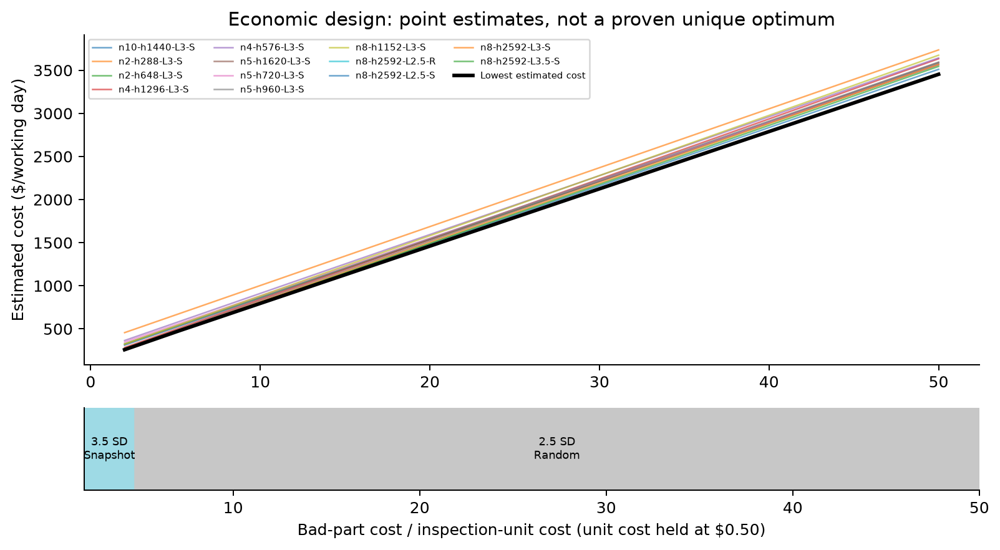
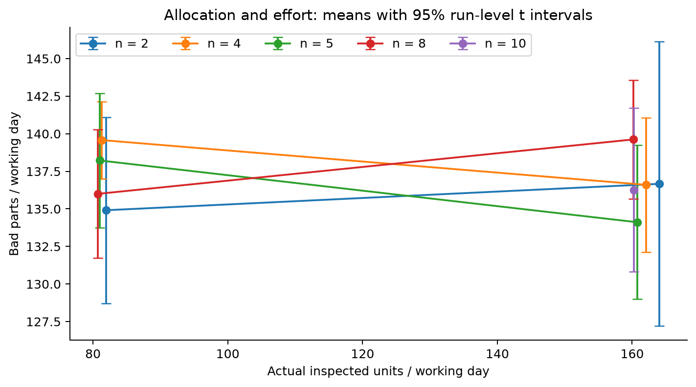

# Economic design of an X-bar chart

**Recommendation under the stated base costs:** n=8, random sampling, 2.5-sigma limits, and a requested simulator wait of 2,592 seconds (43.2 minutes). This produced **82.0 inspected units/day** and the lowest estimated cost among tested plans: **$795.65/day**. It is a conditional simulator recommendation, not a uniquely established or global optimum.



The point-estimate map chooses n=8 / 3.5-sigma / snapshot at cost ratios 2 to 4.733, then n=8 / 2.5-sigma / random above 4.733 through 50. Both use the same requested wait. With inspection cost fixed at $0.50, the switch occurs at a bad-part cost of about $2.37. At the base ratio of 10, the random plan wins **88.8%** of run-level bootstrap resamples. Its estimated $10.64/day advantage over the nearby 3.5-sigma snapshot plan has a 95% Welch interval of **-$9.76 to $31.04**: both remain plausible choices.

## What was completed

**55 experimental runs, 825 simulated working days, 17,459 chart observations, 184,503 quality records, and three pooled baseline runs containing 600 measurements.** All experimental runs cover 15 production dates. All 52 signal records match the out-of-limit chart observations by count and timestamp. No duplicate production-plus-chart output hashes were found. Five focused automated checks passed.

Registered access could not be established using the supplied identifier or the assignment's alternate prefix. The completed experiment therefore uses **guest mode**, which has a different defect profile from the original registered-account labs. The historical reports are audited separately and are never pooled with the new runs. No credentials are included. This limitation prevents claiming that the chosen plan is optimal for the original account.

## Read first

- [Two-page project brief](project_brief.pdf)
- [Answers to the project questions](findings.md)
- [Executed analysis notebook](analysis.ipynb)
- [Methods, assumptions and references](methods.md)
- [Corrected original-lab audit](original_lab_audit.md)
- [Resume bullets](resume_bullets.md)



## Findings in context

No allocation, width, or method omnibus test crosses .05. Increasing effort from roughly 80 to 160 units/day does not establish a consistent quality benefit; the two budgets cannot identify a response-curve knee. The main economic advantage comes from lower sampling expenditure under the assumed cost model. The observed base-case difference from the explicit n=5/h=960 reference is $68.01/day (7.9%), but that reference is not a verified recreation of the historical lab's undocumented interval.

All 52 signals remain unclassified by the conservative pre-signal screening rule. This is not proof that no shifts occurred. It means empirical shift sizes, onset-based delay distributions and true false-alarm counts cannot be established from these records. ARL predictions and a reduced Duncan-style renewal sensitivity are supplied as theory, not fabricated empirical validation. A fitted full Duncan optimum requires cause-state and repair information that the simulator does not expose.

## Reproduce

Python 3.12 was used. In a fresh virtual environment:

```text
python -m pip install -r requirements.txt
python -m unittest test_analysis.py
python analyze.py
python supplement.py
python verify_deliverables.py
python build_report.py
```

Open `analysis.ipynb` in Jupyter to explore the outputs. The notebook rebuilds the analysis from saved captures; collection is separate. `audit_original.py` recalculates the old Phase 1 limits when given the original Lab 7 PDF. Original private PDFs are not redistributed.

## Files

| Location | Contents |
|---|---|
| `runs/<run_id>/` | Complete visible simulator tables in JSON and per-run settings; not original XLS downloads |
| `runs/Baseline01` through `Baseline03` | The three baseline datasets, 200 individuals each |
| `stage0/` | Schedule and sampling-method checks |
| `excluded/` | Incomplete early captures, explicitly excluded from all experiment statistics |
| `collection/` | Exact randomized schedules and the Codex browser collection helper |
| `parse_run.py` | Strict table/horizon/limit validation, signal matching and onset screening |
| `analyze.py`, `supplement.py` | Reproducible statistics, economics, uncertainty and theory |
| `results/run_table.csv` | One row per 15-day experimental replication |
| `results/plan_summary.csv` | Physical-policy means; identical designs pooled across stages |
| `results/cost_regions_exact.csv` | Exact affine cost intersections |
| `results/bootstrap_winners.csv` | Run-level bootstrap winner frequencies, not posterior probabilities |
| `results/validation.csv`, `raw_sha256.json` | Per-run validation and capture hashes |
| `figures/` | PNG and editable SVG figures |

The stages contain 27 allocation runs, three reference runs, 15 width runs and ten method runs. Allocation/reference have three replications per cell; width/method have five. A fixed ten-run precision extension was chosen after initial width results, without stopping based on statistical significance. Identical physical policies are pooled for costs, while experiment-specific tests retain their original groups.

The online simulator has no m field. The approximate 80/160-unit targets were calibrated for collection time; actual allocation effort differs from target by at most 2.67%. The Phase 1 200-unit course cap is not silently treated as a verified Phase 2 cap. The collection helper uses the Codex browser API and is not a standalone Playwright CLI; it never stores login identifiers.

Prepared with Codex assistance from simulator captures and the user-supplied reports. The archived notebook has six executed code cells and no cell errors.
